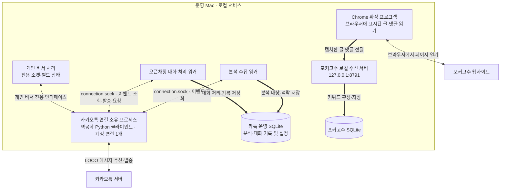
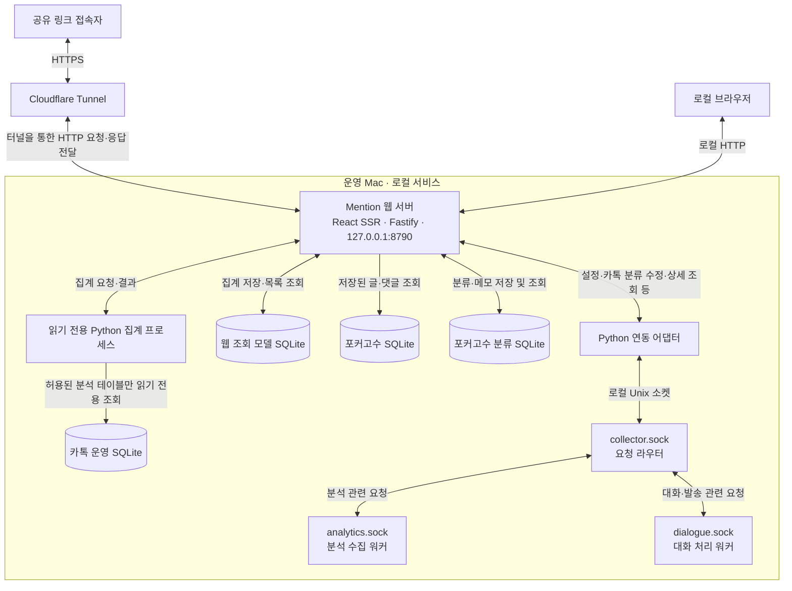

# Mention

카카오톡 오픈채팅과 포커고수에서 서비스 관련 대화를 수집하고, 맥락을 바탕으로 여론을 파악하는 모니터링 대시보드입니다.

## 주요 기능

- **종합 여론:** 같은 대상에 대한 카톡·포커고수 반응을 출처별 수치와 근거로 비교합니다.
- **대화 맥락·분류:** 전후 대화와 게시글·댓글을 확인하고, 여론 분류와 메모를 수정합니다. 사람의 수정과 변경 이력을 보존합니다.
- **키워드 관리:** 대상별 별칭을 묶고, 출처별 수집 여부를 한 번에 설정합니다. 개별 예외와 카톡 제외 문구도 관리합니다.
- **수집·보고:** 수집 대상 방, 누락 구간, 날짜별 CSV, 일일 브리핑과 저장된 이미지 참조를 확인합니다.

미분류는 중립으로 취급하지 않습니다. 카톡 대화와 포커고수 글은 집계 단위가 달라 여론 비율을 합산하지 않습니다. 일부 운영 메뉴는 로컬에서만 표시됩니다.

## 기술 스택

| 구분             | 사용 기술                                                  |
| ---------------- | ---------------------------------------------------------- |
| 프론트엔드       | React 18, TypeScript, React Router 7                       |
| 렌더링·빌드      | React SSR 및 hydration, Vite 8                             |
| 데이터 조회·캐시 | TanStack Query 5                                           |
| UI               | Radix Themes 3, Lucide, 공통 디자인 토큰·컴포넌트          |
| 웹 API           | Node.js 24.14+, Fastify 5, Zod 4                           |
| 저장소           | SQLite — 조회 모델, 포커고수 기록, 분류 이력·처리 영수증   |
| 수집 연동        | Python 어댑터, Unix 도메인 소켓, 로컬 Chrome 확장 프로그램 |
| 검증             | Vitest, Playwright, Biome, Python unittest                 |
| 외부 공유        | Cloudflare Tunnel                                          |

의존성 버전은 `package.json`과 `pnpm-lock.yaml`에서 고정합니다. 회사 표준 스택으로의 이전은 별도 작업 공간에서 진행하며, 현재 운영 웹의 기술 스택은 NestJS·PostgreSQL이 아닙니다.

## 서비스 구조

실제 운영 구조를 수집 흐름과 대시보드 요청 흐름으로 나눴습니다. 실선은 요청·응답, 굵은 화살표는 수집 데이터의 저장 방향입니다.

### 수집 연결



PC 카카오톡 화면을 대시보드가 읽는 구조가 아닙니다. 카카오톡 서버와 통신하는 연결은 소유 프로세스 하나가 유지하고, 수집·대화 처리가 이를 공유합니다. 개인 비서의 전용 상태는 공개 대시보드 조회 대상에서 제외합니다.

### 대시보드 연결·조회



터널 화살표는 웹 요청의 전달 경로입니다. 실제 터널 연결은 Mac의 `cloudflared`가 Cloudflare 쪽으로 생성합니다. 웹 서버가 카카오톡이나 포커고수에 직접 메시지 연결을 만드는 것은 아니며, 웹 재시작과 카카오톡 연결은 분리돼 있습니다. 발송 등 로컬 전용 작업은 공유 링크에서 제한합니다.

### 역공학

카카오톡의 LOCO 메시징 프로토콜을 분석·재구현한 별도 Python 클라이언트와 연동합니다. 대시보드는 해당 클라이언트의 로컬 인터페이스를 사용하며, 별도의 카카오톡 연결을 만들지 않습니다. 클라이언트 구현은 이 저장소 밖에서 관리합니다.

## 개발·실행

Node.js 24.14 이상·27 미만, pnpm 9.15.9가 필요합니다. 실제 카톡 데이터를 보려면 설정된 기존 수집 서비스가 있어야 하며, 이 저장소 설치만으로 카카오톡에 로그인하지 않습니다.

```sh
pnpm install --frozen-lockfile
./scripts/dev.sh start       # http://127.0.0.1:8790
./scripts/dev.sh status
./scripts/dev.sh stop

pnpm verify                 # 타입·린트·단위 테스트·운영 빌드
pnpm test:e2e               # 운영 데이터와 분리한 브라우저 테스트
```

운영 모드는 먼저 빌드한 뒤 `MENTION_PRODUCTION=1 ./scripts/dev.sh start`로 실행합니다. 웹 시작·종료·재시작에는 이 스크립트를 사용합니다. macOS 브라우저 테스트는 Google Chrome을 사용하며, 실행 경로는 `MENTION_CHROME`으로 지정할 수 있습니다.

로컬 배포 설정은 Git에서 제외한 `runtime/deployment.json`에 둡니다. 운영 DB, 인증정보, 원본 대화, 로그, 개인 비서 상태는 커밋하지 않습니다. 수정 요청에는 쓰기 설정과 허용된 요청 출처를 확인하며, 발송·백업 작업은 로컬 전용 제한을 유지합니다.

## 관련 문서

- [서비스 구조](docs/ARCHITECTURE.md) · [개발 기준](DEVELOPMENT.md)
- [디자인 시스템](docs/DESIGN-SYSTEM.md) · [설계 결정](DECISIONS.md)
- [종합 여론·출처별 키워드](docs/COMBINED-OPINIONS.md)
- [포커고수 수집](docs/POKERGOSU.md) · [여론 분류 기준](docs/SENTIMENT-CLASSIFIER.md)
- [이전 범위](docs/MIGRATION.md) · [기능 대응 현황](docs/FEATURE-PARITY.md)
- [배포·롤백](docs/RELEASE.md) · [검증 범위](docs/VERIFICATION.md)
