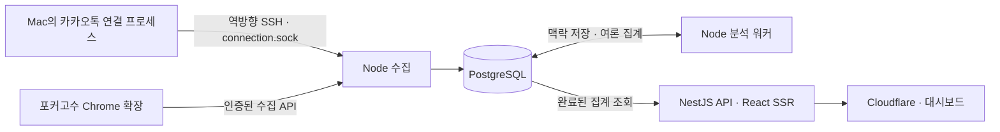

# Mention

카카오톡 오픈채팅과 포커고수의 대화를 수집하고 키워드별 여론을 보여주는 팀 대시보드입니다. 운영 환경은 NestJS·Fastify, React·Vite SSR, PostgreSQL 16·Drizzle을 사용합니다. API, 수집, 집계는 동일한 Docker 이미지에서 역할을 나눠 실행합니다. [운영 이전 기록](docs/MIGRATION-STATUS.md)



로컬 개발에는 Node 24.14.0과 pnpm 9.15.9를 사용합니다. 운영 구성은 `apps/deploy/docker-compose.yml`을 참고하세요. 배포 변경 전에는 `pnpm verify:full`을 실행합니다. [서버 구성과 lenkins 설정](docs/SERVER-CONSOLIDATION.md) · [개발 결정](DECISIONS.md) · [보안 기준](docs/BOILERPLATE-BASELINE.md)

아래는 회사 템플릿의 원본 문서입니다.

# project-boilerplate

**이 저장소를 복사해서 새 프로젝트를 시작한다.** [가이드](https://project-template.mygen.site/llms.txt)의 `bootstrap.md` **Part 1(공통 코어)** 를 그대로 구현한 공통 코어 스켈레톤이다.

> 원칙: **쓰지 않는 블록은 만들지 않는다.** DB·Valkey·인증·worker·WebSocket·업로드·어드민 같은 선택 블록(Part 2)은 이 저장소에 **없다.** 요구가 생긴 시점에 해당 블록만 붙인다. 코어의 구조(레이어·envelope·APP_ROLE 골격·config)는 처음부터 있어야 하므로 여기 포함돼 있다.

## 새 프로젝트 시작 절차

1. 이 저장소를 새 위치로 복사하고 `git init` (또는 템플릿으로 clone). **복사한 boilerplate의 태그/커밋을 DECISIONS.md에 기록한다** — 이후 boilerplate 업데이트를 `git log <그 기준>..HEAD`로 추적·백포트하기 위한 기준점이다.
2. **결정 세션 먼저.** `kickoff.md`(가이드)의 인터뷰로 블록 ON/OFF를 확정하고 루트의 [`DECISIONS.md`](./DECISIONS.md)를 실제 결정으로 채워 커밋한다. 이후 모든 구현 세션은 가이드 전체가 아니라 `DECISIONS.md`에서 시작한다.
3. 프로젝트명/패키지명(`@app/*`)·설명·포트 등을 교체한다.
4. 아래 검증 명령이 모두 통과하는지 확인한다.
5. 결정된 선택 블록을 `bootstrap.md` Part 2 순서대로 하나씩 붙인다.

## 스택 (요약, `tech-stack.md` 기준)

- **워크스페이스**: pnpm + Turbo 2, TypeScript 5.4 strict, Biome, Node 24.14.0(`.node-version`)
- **apps/api**: NestJS 11 + Fastify + swc, 레이어 분리(`modules/{domain}` + `roles/`), APP_ROLE 분기, ResponseInterceptor + GlobalExceptionFilter(envelope `{success,data,error}`), nestjs-pino, zod 검증 config(fail-fast + env 출처 폭포), nestjs-zod 파이프, `@fastify/rate-limit`(전역·인메모리), `/health`
- **apps/web**: Vite 5 + React 18.2 + Tailwind 3.4 + react-router-dom 6.23(v7 future 옵션 OFF), 모든 페이지 React.lazy, ErrorBoundary 2층 + 404/500, apiClient(envelope unwrap + 401 single-flight 골격), TanStack Query 전역 설정, zustand, 런타임 config placeholder 치환
- **packages/shared**: zod 공유 스키마
- **apps/deploy**: 단일 멀티스테이지 Dockerfile(`--target api|web|web-dist`), nginx + entrypoint 치환, `local.yml` compose

## 디렉토리 구조

```
apps/api      NestJS API (레이어/역할/envelope/config/health)
apps/web      Vite + React SPA
apps/deploy   Dockerfile / nginx / compose
packages/shared  공유 zod 스키마
```

## 개발

```bash
pnpm install
# 루트 .env 준비 (compose/entrypoint 및 api config 용)
cp .env.example .env
```

## 로컬 실행 (AI 에이전트 필수)

> **AI 에이전트가 로컬에서 서버/클라를 실행할 때는 반드시 `scripts/dev.sh`를 사용한다.**
> `pnpm dev`, `nest start`, `vite` 등을 직접(특히 백그라운드로) 실행하지 않는다 — 고아 프로세스·포트 충돌·로그 유실 방지.
> 계약과 원칙: [`devenv/local-run-and-debug.md`](https://project-template.mygen.site/llms.txt) (가이드).

```bash
scripts/dev.sh start [api|web|all]     # 백그라운드 기동 (기본 all). 이미 떠 있으면 no-op
scripts/dev.sh start api --debug       # api 를 --inspect=9229 로 (VS Code attach 용)
scripts/dev.sh status [target]         # PID 생존 + 포트 리슨 + api /health 까지
scripts/dev.sh logs [target]           # 최근 100줄 스냅샷 (follow 는 -f — 사람용. AI 는 -f 금지, 로그 파일 직접 읽기)
scripts/dev.sh restart [target]        # stop → start
scripts/dev.sh stop [target]           # SIGTERM→5s→SIGKILL, 스테일 PID 정리
```

- PID: `.dev/pids/<target>.pid` · 로그: `.dev/logs/<target>.log` (start 시 이전 로그는 `.old`로 회전).
- `.dev/`는 **로컬 생성물의 유일한 홈** — 스크린샷·QA 산출물·스크래치·tee 출력(`.dev/tmp/`) 전부 여기로. 폴더만 `.gitkeep`으로 커밋되고 내용물은 커밋되지 않는다.
- 포트: **api 4200**(`/health`), **web 5173**.
- 스테일 PID(파일만 있고 프로세스 없음)는 `status`/`start`가 감지해 정리한다 — "파일 있으니 실행 중"으로 판단하지 않는다.
- 절차: 실행 전 `status` → `start`(또는 `restart`) → 로그 확인 → 작업 끝나면 `stop`.

### 디버깅 (VS Code / Chrome)

환경은 `.vscode/launch.json`에 기본 제공된다 (`.vscode/extensions.json`은 Biome 확장 추천).

- **API (`API: attach (9229)`)**: `scripts/dev.sh start api --debug` 로 띄운 뒤 이 구성으로 **attach**. 프로세스 lifecycle 은 dev.sh 가 소유하고 디버거는 붙었다 떨어질 뿐이다(launch 아님 — dev.sh 의 PID 관리와 충돌 방지).
- **API 테스트 (`API: vitest current file`)**: 현재 열린 vitest 파일을 디버그.
- **Web (`Web: Chrome (5173)`)**: `scripts/dev.sh start web` 후 Chrome 을 디버그 모드로 띄워 Vite dev 서버에 연결(소스맵 매핑).

## 검증 명령 (bootstrap Part 1 체크리스트)

체크리스트는 스크립트로 고정돼 있다 — 항목별 수동 실행으로 대체하지 않는다 (AGENTS.md §3).

```bash
pnpm verify        # lint → build → 유닛 → e2e (매 작업 마무리·커밋 전)
pnpm verify:full   # verify + docker build 전 target + compose config + dist placeholder grep (배포 관련 변경 시)

# 실기동 확인 (compose)
docker compose -f apps/deploy/local.yml up          # api + web 기동 → http://localhost:4200/health
```

## APP_ROLE (단일 이미지, 다중 역할)

이미지는 하나만 빌드하고 `APP_ROLE` 환경 변수로 역할을 분기한다(`api` / `worker` / `all`). 코어에는 `api` 역할만 살아 있고, worker(크론/큐) 블록을 도입하면 `roles/worker.module.ts`를 추가해 `hasRole('worker')`로 연결한다. → `deployment/single-image-roles.md`

## 선택 블록을 붙일 때

`bootstrap.md` Part 2 + `decision-guide.md`를 따른다. 코드 안에 남긴 `TODO(... 블록)` 주석이 붙일 지점을 가리킨다(예: `SystemErrorService`의 DB INSERT, rate-limit의 Valkey store 교체, e2e의 testcontainers globalSetup).
